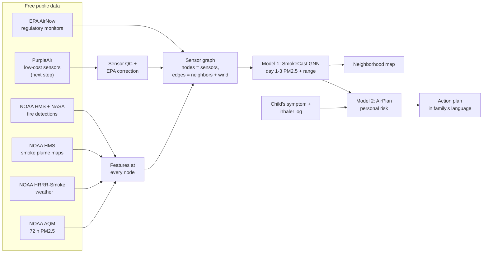

# Serein

**Neighborhood-level wildfire smoke forecasts, 1 to 3 days ahead, with a personal risk plan for each child with asthma.**

> *Serein* (n.): fine rain falling from a clear sky after sunset. Clean air arriving when you need it.

Wildfire smoke now drives a large share of the worst air-quality days in the U.S. Children with asthma are hit hardest. Smoke inflames their airways, and an attack can begin a day or two after exposure. Today's public forecasts have three gaps:

1. **They are coarse.** NOAA's smoke model (HRRR-Smoke) runs on a 3 km grid and is often wrong by a lot when the plume arrives. EPA's AQI forecast covers a whole metro "reporting area".
2. **They ignore what sensors are measuring right now.** About 400 EPA monitors in the western U.S. (and tens of thousands of low-cost PurpleAir sensors) see the smoke arrive hours before the next model run, but the forecast a family reads doesn't use those readings. Serein uses the EPA monitors today; adding PurpleAir sensors is next (TODO A-12, A-14).
3. **They give everyone the same advice.** "Unhealthy for sensitive groups" doesn't tell a parent whether *their* child will be fine at 40 µg/m³ or need the inhaler at 20.

Serein closes all three gaps:

| | What it does | How |
|---|---|---|
| **Model 1: SmokeCast** | Corrects NOAA's smoke forecast with live sensor readings and gives a forecast for every neighborhood, with an honest uncertainty range | A graph neural network on the network of air sensors. Each sensor learns from its neighbors (NOAA forecasts, weather and fires are inputs too). Calibrated with conformal prediction. |
| **Model 2: AirPlan** | Learns each child's own smoke sensitivity from a symptom and inhaler log and turns tomorrow's forecast into a personal action plan in the family's own language | A hierarchical Bayesian model. It starts from what the medical literature says about all kids, then personalizes as the log grows. |
| **Proof: Backtest** | Tests SmokeCast against NOAA's and EPA's real forecasts on the same days. The final test is on 2024-25 fire seasons the model never trained or was tuned on (not run yet; current numbers are 2023 development results) | A pre-registered backtest protocol on held-out seasons, with fixed metrics (see [docs/BACKTEST_PROTOCOL.md](docs/BACKTEST_PROTOCOL.md)) |

---

## Getting started

Follow the steps in order. Each step says how to check that it worked before moving on.

### Step 1. Look at the results (no install needed)
Open [docs/results/](docs/results/README.md). It has the full development report, the head-to-head comparison against NOAA and EPA, and every figure.

### Step 2. Install the tools
1. Install [git](https://git-scm.com/downloads).
2. Install [uv](https://docs.astral.sh/uv/getting-started/installation/). uv installs the right Python version by itself.

Check: `git --version` and `uv --version` both print a version number.

### Step 3. Get the code and install it
```bash
git clone https://github.com/htvarkali/Serein
cd Serein
uv sync --all-extras
```
Check: `uv run pytest` ends with `passed` and no failures.

### Step 4. Try the parts that need no data
```bash
uv run serein airplan-demo --seed 3 --language es     # a simulated child's action plan, in Spanish
uv run streamlit run app/streamlit_app.py             # demo app; uses the sample forecast in app/sample/
```
Check: the first command prints a green and a red action plan; the second opens a map in the browser.

The family-plan tab uses a synthetic child and simulated symptom history, including when
you change the number of history days. Daily check-ins are a separate demonstration:
use fictional entries only. They are held in memory on the app server for the session,
with CSV export and a **Clear session log** button; they are not saved to a database.

### Verification and next steps

Run `uv run pytest -q` and `uv run ruff check .` before a push. The suite includes
the app interactions and a small, real two-seed training → calibration → export →
forecast check using synthetic environmental data. GitHub Actions runs these checks
with CPU PyTorch and app extras on pull requests and pushes to `main`.

See [the next steps](docs/NEXT_STEPS.md) for the order of remaining work and
[PurpleAir QC](docs/PURPLEAIR_QC.md) for the new offline sensor-screening command.

### Step 5 (optional). Download the data and train models
Only needed for tasks that train or score models (most A, B and D tasks).
- `./scripts/download_all.sh` pulls 5 fire seasons of free public data. About 2-3 hours, roughly 150 GB downloaded, about 2.2 GB kept on disk. No API keys needed.
- An NVIDIA GPU makes training much faster but is not required.
- Then follow [Quick start](#quick-start) steps 2-4.

Check: `uv run serein backtest --seeds 1 --epochs 5 --tag smoke_test` finishes and writes `outputs/backtest/west_us_smoke_test/report.md`.

### Step 6. Pick a task
1. Open the [Task board](#task-board) and choose a row with status **Open**.
2. Claim it: in a small commit or pull request, change that row's status to **In progress** and put your GitHub username in the Owner column. One person per task. If a row already has an owner, pick a different task or ask that owner.
3. If the task needs a person rather than code (interviews, reviews, video, business plan), it is marked **(non-code)** in the board.

### Step 7. Do the work
1. Make a branch named after the task: `git checkout -b b8-purpleair-nodes`.
2. Keep changes to what the task describes.
3. Add a test in `tests/` for anything that computes a number.
4. Before pushing, both must pass: `uv run pytest` and `uv run ruff check .`

### Step 8. Finish the task
1. Open a pull request that names the task ID in its title (for example `B-8: add PurpleAir nodes`).
2. One other contributor reviews before merging.
3. In the same pull request, set the row's status to **Done** and fill in the date.

### Rules that apply to every task
- **Never run the final test (`--final`) alone.** It runs once, after the protocol is frozen. See [Finishing the proof](#finishing-the-proof-the-final-test-do-this-once).
- **Never commit data files, API keys, or any real person's health information.** `.gitignore` blocks the common cases; check `git status` before every commit anyway.
- **Report results honestly**, including where Serein loses. Numbers in docs must come from a file in `outputs/` or `docs/results/`.
- **Health messages need human review.** Never ship a machine translation or new medical wording without a native speaker or clinician checking it.

---

## How it works



**The forecast target.** The 24-hour average PM2.5 (µg/m³) for each local day, at each location. This is the quantity the EPA AQI uses (2024 breakpoints: Good ≤ 9.0, Moderate ≤ 35.4, USG ≤ 55.4, Unhealthy ≤ 125.4, Very Unhealthy ≤ 225.4).

**Issue time.** 18:30 UTC (11:30 am Pacific daylight time) each day, using only data that existed at that moment: the 12z HRRR run (on AWS by ~13:55 UTC), the 12z AQM run (on AWS by ~18:03 UTC), and sensor hours ending by 17:00 UTC. We measured those posting times from AWS timestamps. This "no peeking" rule is enforced in code (`serein/data/availability.py`) and tested.

| Lead | What official guidance exists | What Serein uses |
|---|---|---|
| Day 0 (today) | HRRR-Smoke, AQM, EPA forecast | all of it + live sensors |
| Day 1 (tomorrow) | HRRR-Smoke (to 48 h), AQM, EPA forecast | all of it + sensors |
| Day 2 | AQM only (72 h since July 2021; 48 h before) | AQM + sensors + weather |
| Day 3 | **nothing official for smoke** | sensors + fires + weather. This is where Serein adds the most. |

---

## Data sources (all free, all checked on 2026-11-01)

| Source | What | Access | Key needed? |
|---|---|---|---|
| [NOAA HMS Fire](https://www.ospo.noaa.gov/products/land/hms.html) | Daily VIIRS/MODIS/GOES fire detections + fire radiative power (we use VIIRS/MODIS) | `satepsanone.nesdis.noaa.gov/pub/FIRE/web/HMS/Fire_Points/` | No |
| [NASA FIRMS](https://firms.modaps.eosdis.nasa.gov/api/) (optional) | Same satellites, NASA processing | REST API | Free MAP_KEY |
| [NOAA HMS Smoke](https://www.ospo.noaa.gov/products/land/hms.html) | Daily smoke plume polygons (light/medium/heavy) | `satepsanone.nesdis.noaa.gov/pub/FIRE/web/HMS/Smoke_Polygons/` | No |
| [PurpleAir](https://develop.purpleair.com/) | ~30k low-cost PM2.5 sensors | REST API. **Costs points per row**; see note below | Free key, paid points |
| [EPA AirNow](https://docs.airnowapi.org/) | Hourly regulatory PM2.5 + archived official AQI forecasts | `files.airnowtech.org/airnow/YYYY/YYYYMMDD/` | No |
| [NOAA HRRR-Smoke](https://registry.opendata.aws/noaa-hrrr-pds/) | 3 km smoke (`MASSDEN` 8 m, `COLMD` column) + weather, 48 h | AWS `noaa-hrrr-bdp-pds`, byte-range downloads using the `.idx` files | No |
| [NOAA AQM (NAQFC)](https://registry.opendata.aws/noaa-nws-naqfc-pds/) | Official 72 h PM2.5 forecast (raw + bias-corrected) | AWS `noaa-nws-naqfc-pds` | No |

> **PurpleAir cost note.** PurpleAir bills API calls in "points", so pulling years of history for thousands of sensors costs real money. Our approach: (1) the core backtest runs on **free EPA monitors only**, so the headline result doesn't depend on PurpleAir; (2) PurpleAir is added for a smaller set of sensors, using `serein purpleair estimate` before every download; (3) we ask PurpleAir for research/student access (see TODO D-3).

Gotchas we found (details in [docs/DATA.md](docs/DATA.md)): HRRR `MASSDEN` was labeled µg/m³ before 2021-12-21 and kg/m³ after (the loader detects it). AQMv5 (to 2021-07-19) only runs 48 h. AQM's ready-made 24 h files don't use local calendar days, so we average the hourly files ourselves. EPA forecasts are issued *after* our issue time, which favors EPA in the comparison.

---

## Current results (historical dev snapshot, 2026-11-02)

These saved numbers predate the latest observation-processing, missing-smoke-map,
forecast-bound and ensemble-export fixes. New graph/no-graph runs also use matching
ensemble sizes. Rebuild feature tables and rerun the development suite before
updating these results or claiming accuracy for the revised pipeline.

Trained on 2021-22 fire seasons, scored on held-out weeks of 2023. **These are
development numbers, not the final test.** The 2024-25 test seasons are locked
until the protocol is frozen (TODO D-4/D-5).

| Error (RMSE, µg/m³) | Today | +1 day | +2 days | +3 days |
|---|---|---|---|---|
| **SmokeCast** | **4.5** | **7.9** | **9.7** | **11.4** |
| AQM → HRRR → persistence fallback | 10.1 | 11.0 | 12.3 | 15.5 |
| Same model, graph turned off | 4.8 | 8.2 | 10.3 | 12.0 |
| **At monitors hidden from SmokeCast** (no sensor) | **7.0** | **8.5** | **10.1** | **11.3** |
| NOAA at those same hidden monitors | 10.5 | 11.1 | 11.9 | 14.1 |

The fallback selects forecasts by availability, in the order shown. Its day-3
prediction can be persistence when NOAA forecasts are unavailable.

- Beats that fallback at every lead (day-bootstrap 95% CIs all below zero), and
  beats NOAA at 87% of 344 individual monitors (day 1).
- **Warnings a day ahead:** of 244 reporting-area days that really turned orange-or-worse,
  Serein warned on 71% vs. 46% for EPA's official forecast, with fewer false alarms
  (81 vs. 98). Day 2: 66% vs. 37%, but more false alarms (54 vs. 36).
- **Peaks:** on smoky days, the day-1 forecast reaches a median 80% of the true level
  (NOAA: 31%); day 2: 56%, day 3: 31%.
- The graph matters most where there is **no sensor**: 17% lower error today and 16% on
  day 3 at hidden monitors vs. the same model without neighbors.
- 90% ranges contain the truth 89-91% of the time.
- Weak spots we report: big peaks are still under-forecast at days 2-3; day-2 warnings
  have more false alarms than EPA's.
- **What drives the skill** (ablations): live sensors matter most for today (+66% error
  without them), HRRR-Smoke for days 1-2 (+29% on day 1), AQM for every day (+7-14%).
  Fire detections and smoke plume maps help a little (1-5% on days 1-3); wind direction
  on graph edges adds nothing (details in `docs/METHODS.md`).

Figures: `outputs/backtest/west_us_dev/`. Map: `outputs/maps/map_20230818.png`.

For peak and warning diagnostics, the [episode report](docs/EPISODE_EVALUATION.md)
audits saved development forecasts against contiguous high-PM periods. It compares
models on common complete episodes and retains missing forecasts and unknown
episode boundaries. B-15 remains open; this report measures the problem.

---

## Repo layout

```
Serein/
├── README.md               ← you are here (task board at the bottom)
├── configs/
│   ├── west_us.yaml        ← main study: region, seasons, train/calibrate/test split
│   └── northeast_2023.yaml ← out-of-region transfer test (June 2023 Canadian smoke)
├── docs/
│   ├── CONRAD.md             ← what Conrad requires + how judges score
│   ├── BACKTEST_PROTOCOL.md  ← the rules for "proof"; freeze before the final test
│   ├── METHODS.md            ← model math in plain English + cited priors
│   ├── DATA.md / DATA_DICTIONARY.md ← data sources, quirks, every column
│   ├── ETHICS.md             ← child health data, consent, safety
│   ├── results/              ← snapshot of dev results + figures (no data download needed)
│   └── drafts/               ← unsent drafts (Innovation Brief, PurpleAir request)
├── src/serein/
│   ├── data/               ← downloaders + parsers (one file per source)
│   ├── features/           ← sensor graph + feature tables
│   ├── models/             ← baselines, SmokeCast GNN, conformal calibration, maps
│   ├── personal/           ← AirPlan: personal model, action plans, daily check-in
│   ├── eval/               ← metrics, backtest, figures, impact, transfer test
│   └── cli.py              ← `serein ...` command line
├── scripts/                ← download_all, run_dev_suite, run_ablations, build_website ...
├── app/                    ← demo app: map, family plan, daily check-in
├── website/                ← draft of the Conrad website (static HTML)
├── tests/                  ← pytest; run before every push
├── data/                   ← local data cache, git-ignored (never commit data)
└── outputs/                ← results + figures, git-ignored
```

## Quick start

You need [uv](https://docs.astral.sh/uv/) and git. Everything else installs itself.

```bash
git clone https://github.com/htvarkali/Serein
cd Serein
uv sync --all-extras          # installs Python 3.12 + all packages (PyTorch with CUDA on Win/Linux)
uv run pytest                 # should be all green

# 1) Download the free data (all 5 seasons: ~2-3 h on a fast connection)
./scripts/download_all.sh
# 2) Build feature tables
uv run serein build-table --split train
uv run serein build-table --split calibrate
uv run serein build-table --split test        # builds features only; does not score
# 3) Everything that scores on 2023 dev weeks (main run, hidden-monitor test, ablations, figures)
./scripts/run_dev_suite.sh
# 4) Demos
uv run serein airplan-demo --seed 3 --language es
uv run serein map --date 2023-08-18 --run west_us_dev
uv run streamlit run app/streamlit_app.py
```

On Windows, use the [native Python development runner](docs/WINDOWS_DEVELOPMENT.md)
to run the study without Bash, with separate output folders and a suite time limit.
It also exports [paired forecast comparisons](docs/FORECAST_COMPARISON.md).

No API keys are needed for the main study. Optional keys (NASA FIRMS, PurpleAir) go in a `.env` file at the repo root (never committed); see `.env.example`.

## Finishing the proof: the final test (do this ONCE)

The 2024-25 seasons have never been scored. Doing it in this order is what makes the
result trustworthy to judges:

1. Read `docs/BACKTEST_PROTOCOL.md` together and agree on it. Change its status line to **FROZEN**.
2. Commit and push it. The commit time is your public proof the rules came first.
3. Run the test (about 10 min on an RTX-class GPU):
   ```bash
   uv run serein backtest --final
   uv run serein backtest --final --tag final_holdout --holdout-sites 0.2 --no-gbm
   uv run python -m serein.eval.figures outputs/backtest/west_us_final
   uv run python -m serein.eval.impact outputs/backtest/west_us_final
   ```
4. Run the out-of-region test once:
   ```bash
   uv run serein build-table --config configs/northeast_2023.yaml --split test   # already built locally
   uv run serein transfer --run west_us_final
   ```
5. Report every number, including any where Serein loses. Update the results table
   above, `website/index.html`, and run `RUN=outputs/backtest/west_us_final ./scripts/build_website.sh`.

`--final` writes a lock file; running it again requires `--force` plus a written reason
in the protocol's change log.

## Timeline

Official 2026-27 Conrad dates ([Student Guide](https://conrad.spacecenter.org/wp-content/uploads/2026/08/2026-2027-Conrad-Challenge-Student-Guide-Official.pdf), checked 2026-11-01): the Lean Canvas was due **Oct 29, 2026**; the Innovation Stage (Brief + 3-5 min video + website + $499 fee) closes **Jan 7, 2027, 11:59 pm CT**. The internal target is **Jan 1, 2027**. Full requirements and the judges' scoring guide: [docs/CONRAD.md](docs/CONRAD.md).

| Week of | Milestone |
|---|---|
| Nov 2 | Data pipeline works for 1 season; baselines scored (M1) |
| Nov 16 | First GNN beats raw HRRR on validation season (M2) |
| Nov 30 | Backtest protocol frozen; uncertainty calibrated; AirPlan simulation done (M3) |
| Dec 7 | **Run the final held-out test once.** Freeze numbers (M4) |
| Dec 14 | Demo app + action plans in 3+ languages reviewed by native speakers (M5) |
| Dec 21 | Innovation Brief + business plan drafts; expert feedback (M6) |
| Jan 1 | Everything final (M7) |

---

## Task board

**Status key:** **Done** = finished and merged · **In progress** = claimed, being worked on · **Open** = free to claim · **Blocked** = waiting on something outside the repo. ⭐ = on the critical path for the headline result. **(non-code)** = needs a person, not code.

### Summary: what is left (updated 2026-11-07)

| Area | Done | In progress | Open | Blocked |
|---|---|---|---|---|
| A: Data pipeline | 13 | 1 | 1 | 0 |
| B: SmokeCast (Model 1) | 16 | 1 | 3 | 0 |
| C: AirPlan (Model 2) | 10 | 0 | 3 | 0 |
| D: Proof & science | 8 | 0 | 3 | 1 |
| E: Product & pitch | 4 | 0 | 7 | 0 |
| S: Submission (Conrad) | 2 | 0 | 9 | 0 |
| Q: Code quality | 6 | 2 | 1 | 0 |

The `htvarkali` items below are implemented on the reliability/QC branch and
remain **In progress** until reviewed and merged. Historical results are unchanged.

**Most urgent open work, in order:**
1. S-1 Confirm in the Conrad portal that the Lean Canvas was submitted (due Oct 29) and which category was chosen. If it was not submitted, the entry cannot compete.
2. S-3 to S-6 Finish the Innovation Brief: every `[TEAM: ...]` slot in [docs/drafts/innovation_brief.md](docs/drafts/innovation_brief.md), especially questions 6-10 (market, competition, go-to-market, business model, fundraising).
3. S-8 Website team section and contact line. S-9 the 3-5 minute video.
4. D-4, D-5, D-6b ⭐ Freeze the protocol, then run the final test and the transfer test once.
5. C-8 One clinician review and E-1 interviews: the strongest outside evidence a judge can see.

### A: Data pipeline
| ID | Task | Status | Owner | Date |
|---|---|---|---|---|
| A-1 | Repo scaffold, `pyproject.toml`, uv env with CUDA PyTorch | Done | Aadi-Tiwari | 2026-11-01 |
| A-2 | AirNow hourly PM2.5 downloader + parser (free, no key) | Done | Aadi-Tiwari | 2026-11-01 |
| A-3 | AirNow archived **official AQI forecasts** (`reportingarea.dat`) parser: the EPA baseline | Done | Aadi-Tiwari | 2026-11-01 |
| A-4 | NOAA HMS smoke polygons downloader + "smoke density at point" feature | Done | Aadi-Tiwari | 2026-11-01 |
| A-5 | HRRR-Smoke `MASSDEN`, column smoke `COLMD` and weather at sites via byte-range downloads | Done | Aadi-Tiwari | 2026-11-01 |
| A-6 | NOAA AQM 72 h PM2.5 at sites (raw + bias-corrected) | Done | Aadi-Tiwari | 2026-11-01 |
| A-7 | Fire features from NOAA HMS fire points (no key); NASA FIRMS code included for anyone with a key | Done | Aadi-Tiwari | 2026-11-01 |
| A-8 | PurpleAir client, point-cost estimator, EPA correction (Barkjohn 2021 + high-smoke extension); needs a key to use | Done | Aadi-Tiwari | 2026-11-01 |
| A-9 | "No peeking" rules: only data that existed at issue time | Done | Aadi-Tiwari | 2026-11-01 |
| A-10 ⭐ | Full download of all 5 seasons (EPA, HMS, HRRR, AQM); about 2.2 GB on disk | Done | Aadi-Tiwari | 2026-11-01 |
| A-11 | AQM archive v5/v6/v7 loader (v5 to 2021-07-19 is 48 h only) | Done | Aadi-Tiwari | 2026-11-01 |
| A-12 | Offline PurpleAir QC: auditable A/B, indoor, stuck and neighbor screening; CLI and synthetic tests ([guide](docs/PURPLEAIR_QC.md)) | In progress | htvarkali | 2026-11-04 |
| A-13 | HRRR weather at sites: 10 m wind, PBL height, RH, 2 m temperature (precipitation not yet added) | Done | Aadi-Tiwari | 2026-11-01 |
| A-14 | PurpleAir history for ~300 sensors in 2 test metros (Sacramento, Portland), after the cost estimate is approved | Open | | |
| A-15 | Data dictionary generated from the real table: `docs/DATA_DICTIONARY.md` | Done | Aadi-Tiwari | 2026-11-01 |

### B: SmokeCast (Model 1)
| ID | Task | Status | Owner | Date |
|---|---|---|---|---|
| B-1 | Baselines: persistence, climatology, raw HRRR-Smoke, raw and bias-corrected AQM, EPA forecast | Done | Aadi-Tiwari | 2026-11-01 |
| B-2 | Sensor graph builder (k nearest neighbors, distance + bearing edge features) | Done | Aadi-Tiwari | 2026-11-01 |
| B-3 | GNN v0: message passing, residual on top of AQM/HRRR, quantile outputs, lead days 0-3 | Done | Aadi-Tiwari | 2026-11-01 |
| B-4 | Conformal calibration so the "90% range" contains the truth about 90% of the time | Done | Aadi-Tiwari | 2026-11-01 |
| B-5 | Gradient-boosting baseline with no graph, to test whether the graph helps | Done | Aadi-Tiwari | 2026-11-01 |
| B-6 ⭐ | Trained on 2021-22, tuned on 2023 dev weeks only; settings frozen in BACKTEST_PROTOCOL §6b | Done | Aadi-Tiwari | 2026-11-01 |
| B-7 | Node masking in training (hides readings and site history of 15% of sensors) | Done | Aadi-Tiwari | 2026-11-01 |
| B-7b | Leave-sites-out test (`--holdout-sites 0.2`) | Done | Aadi-Tiwari | 2026-11-01 |
| B-8 | Add PurpleAir nodes; measure how much low-cost sensors help (needs A-12, A-14) | Open | | |
| B-9a | Map v0: `serein map --date ...` on a 0.25° grid | Done | Aadi-Tiwari | 2026-11-01 |
| B-9b | Kilometer-grid development forecasts, footprint maps and area-weighted tract summaries; exercised around Sacramento and Portland ([guide](docs/NEIGHBORHOOD_MAPS.md)) | Done | Aadi-Tiwari | 2026-11-06 |
| B-10a | Graph vs. no-graph + settings sweep (`scripts/sweep_graph.sh`) | Done | Aadi-Tiwari | 2026-11-01 |
| B-10b | Input ablations: sensors, HRRR, AQM matter most; fires and plumes help a little; wind-on-edges doesn't (table in `docs/METHODS.md`) | Done | Aadi-Tiwari | 2026-11-01 |
| B-11 | Explainability: `serein explain` shows which input groups moved a forecast (integrated gradients) and which neighbors the graph listened to (`docs/METHODS.md`) | Done | Aadi-Tiwari | 2026-11-02 |
| B-12 | 5-seed ensemble (`--seeds 5`, now the default) | Done | Aadi-Tiwari | 2026-11-01 |
| B-12b | Export/load every ensemble member for maps, transfer and explanations; compare graph/no-graph with equal seed counts | In progress | htvarkali | 2026-11-04 |
| B-13 | Smoke days weighted 6x in training: day-1 forecasts reach a median 80% of the true peak (NOAA: 31%) | Done | Aadi-Tiwari | 2026-11-01 |
| B-14 | Places without a sensor get a base forecast from neighbors' readings | Done | Aadi-Tiwari | 2026-11-01 |
| B-15 | Peaks still under-predicted at days 2-3. Options: add 2020 as training data (no HRRR smoke fields that year, but AQMv5 and weather exist), or a heavy-tailed output | Open | | |
| B-16 | Smoke-transport features HRRR lacks (plume age, fire growth rate), or drop fire inputs to simplify | Open | | |

The [neighborhood workflow](docs/NEIGHBORHOOD_MAPS.md) uses separate registries and
NOAA caches, preserves missing tract coverage, and exports sensor support audits.
The finer display grid does not establish finer forecast skill or calibrated
uncertainty at new locations; those still need spatial validation.

The [interval diagnostic report](docs/INTERVAL_DIAGNOSTICS.md) checks saved
development bounds by monitor, issue month and previous-day smoke, with missing
row counts and calendar-block bootstrap intervals. These exploratory checks do
not establish conditional or spatial calibration.

### C: AirPlan (Model 2)
| ID | Task | Status | Owner | Date |
|---|---|---|---|---|
| C-1 | Hierarchical Bayesian logistic model (population prior to per-child posterior) | Done | Aadi-Tiwari | 2026-11-01 |
| C-2 | Synthetic cohort simulator: checks the model recovers a child's true sensitivity | Done | Aadi-Tiwari | 2026-11-01 |
| C-3 | Action-plan engine: green/yellow/red zones from personal risk, based on CDC/EPA/AAP guidance | Done | Aadi-Tiwari | 2026-11-01 |
| C-4 | Message templates: English + Spanish draft | Done | Aadi-Tiwari | 2026-11-01 |
| C-5 | Literature review: priors cite Sugrue 2026, Khetsuriani 2007, Williams 2011, CDC ACBS (`docs/METHODS.md`) | Done | Aadi-Tiwari | 2026-11-01 |
| C-6 ⭐ | Simulation study: 300 synthetic children; personal model beats one-size-fits-all from ~2 weeks of logs | Done | Aadi-Tiwari | 2026-11-01 |
| C-7a | Spanish wording aligned with EPA's official Spanish AQI names and CDC asthma terms | Done | Aadi-Tiwari | 2026-11-01 |
| C-7 | **(non-code)** Native-speaker review of `src/serein/personal/messages/es.yaml`; later Chinese, Vietnamese, Tagalog, Hindi/Punjabi | Open | | |
| C-8 | **(non-code)** Pediatric pulmonologist, asthma educator or school nurse reviews action-plan wording and the priors table (includes C-5b). Record their feedback | Open | | |
| C-9 | Daily check-in: 6 taps (`serein/personal/log.py`) + "Daily check-in" tab in the app; fictional entries held in server memory for the session, with CSV export and a clear-log button | Done | Aadi-Tiwari | 2026-11-01 |
| C-10 | Confounders in the child model: ozone (prior from Strickland 2010), hot day and high-pollen day (wide "no effect" priors), next to the existing cold/virus term. They never trigger a smoke warning on their own (`docs/METHODS.md#priors`) | Done | Aadi-Tiwari | 2026-11-02 |
| C-10b | AQM ozone and maximum hourly HRRR temperature feed family plans with complete-day coverage checks; optional pollen check-in ([guide](docs/FORECAST_CONTEXT.md)) | Done | Kwilier | 2026-11-07 |
| C-11 | More languages in `messages/` (only after C-7 sets the review process) | Open | | |

### D: Proof & science
| ID | Task | Status | Owner | Date |
|---|---|---|---|---|
| D-1 | Metrics: RMSE, MAE, bias, AQI-category accuracy, warning hit rate / false alarms (CSI), CRPS, interval coverage | Done | Aadi-Tiwari | 2026-11-01 |
| D-2 | Backtest runner with strict season split and a `--final` lock file | Done | Aadi-Tiwari | 2026-11-01 |
| D-2b | Warning rule: warn when P(PM2.5 ≥ 35.5) beats a cut-off tuned on calibration weeks | Done | Aadi-Tiwari | 2026-11-01 |
| D-3 | **(non-code)** PurpleAir research access: draft in `docs/drafts/purpleair_data_request.md`, not sent; someone must decide whether to send it | Blocked | | |
| D-4 ⭐ | Read and **freeze** `docs/BACKTEST_PROTOCOL.md` before scoring the test seasons (the commit time is the proof) | Open | | |
| D-5 ⭐ | Run the final test once (`--final`), with day-bootstrap 95% CIs and a Diebold-Mariano test vs. each baseline | Open | | |
| D-6a | Northeast June 2023 transfer test prepared: data downloaded, `serein transfer` built | Done | Aadi-Tiwari | 2026-11-01 |
| D-6b ⭐ | Run the transfer test once, right after D-5 | Open | | |
| D-7 | Figures: error vs. lead, warnings vs. EPA, case study, calibration, improvement map, peak report | Done | Aadi-Tiwari | 2026-11-01 |
| D-8 | Impact calculator: smoky days warned a day ahead, Serein vs. EPA | Done | Aadi-Tiwari | 2026-11-01 |
| D-9 | Results snapshot in `docs/results/` so results can be read without the data download | Done | Aadi-Tiwari | 2026-11-01 |
| D-10 | Independent rubric-based review of the whole entry; fixes applied to README and website wording | Done | Aadi-Tiwari | 2026-11-01 |

### E: Product & pitch
| ID | Task | Status | Owner | Date |
|---|---|---|---|---|
| E-1 | **(non-code)** Interviews: 5+ parents of children with asthma, 2+ school nurses, 1+ pediatric doctor. Notes in `docs/interviews/` (no names) | Open | | |
| E-2 | Demo app v0 (`uv run streamlit run app/streamlit_app.py`): map, family plan, check-in | Done | Aadi-Tiwari | 2026-11-01 |
| E-2b | Polish the app using interview feedback (needs E-1) | Open | | |
| E-2c | Sample forecast shipped in `app/sample/` so the app works without the data download | Done | Aadi-Tiwari | 2026-11-01 |
| E-3 | SMS and WhatsApp mockups in English and Spanish, made from the real code, with SMS part counts for pricing ([docs/mockups/messages.md](docs/mockups/messages.md)) | Done | Aadi-Tiwari | 2026-11-02 |
| E-3b | Third language for the mockups (only after C-7 sets the review process; see C-11) | Open | | |
| E-4 | **(non-code)** Business model: free for families; who pays (school districts, health plans, air districts), with prices and sources ([numbers](docs/BUSINESS_NUMBERS_2026-11-07.md) done; price confirmation needs E-1) | In progress | AbhinavGGarg | 2026-11-08 |
| E-5 | **(non-code)** Competitor table: verify every row in the Brief draft (AirNow, PurpleAir, IQAir, Apple/Google, Propeller Health, EPA Smoke Sense, published research models); [source verification](docs/COMPETITOR_VERIFICATION_2026-11-07.md) | Done | Kwilier | 2026-11-07 |
| E-6 | **(non-code)** Business plan and pitch from the Lean Canvas | Open | | |
| E-7 | **(non-code)** Letters of support (school district, air district, asthma nonprofit) | Open | | |
| E-8 | **(non-code)** IP decision: keep code open and protect the name, or move models private; trademark search on "Serein" ([memo](docs/drafts/ip_decision_memo.md): live SEREIN mark in classes 9/42/44; decision pending) | In progress | AbhinavGGarg | 2026-11-08 |

### S: Submission (Conrad Innovation Stage, due 2027-01-07, internal target 2027-01-01)
| ID | Task | Status | Owner | Date |
|---|---|---|---|---|
| S-1 | **(non-code)** Confirm the Lean Canvas was submitted on Oct 29 and which category was chosen | Open | | |
| S-2 | Brief first draft with all 10 questions and dev numbers: [docs/drafts/innovation_brief.md](docs/drafts/innovation_brief.md) | Done | Aadi-Tiwari | 2026-11-01 |
| S-3 | **(non-code)** Brief Q2 Team: names, grades, roles, advisor | Open | | |
| S-4 | **(non-code)** Brief Q3 and Q5: add interview findings (E-1) and expert feedback (C-8) | Open | | |
| S-5 | **(non-code)** Brief Q6-Q10: market, competition, go-to-market, business model, fundraising (E-4 to E-7) (Q6, Q8, Q9, Q10 merged 2026-11-08; 4 `[TEAM]` slots left; Q7 alternative paragraph in the draft file) | In progress | AbhinavGGarg | 2026-11-08 |
| S-6 | Brief Q4 and Q5: replace dev numbers with final test numbers after D-5 | Open | | |
| S-7 | Draft website (`website/index.html`) with results, figures, safety section | Done | Aadi-Tiwari | 2026-11-01 |
| S-8 | **(non-code)** Website: team section, contact line, logo and colors; publish at a direct link | Open | | |
| S-9 | **(non-code)** 3-5 minute video: the problem, the app map, the backtest chart, a plan being generated. YouTube/Vimeo link + MP4 under 800 MB | Open | | |
| S-10 | **(non-code)** Reference list and up to 2 attachments (backtest figure, map or app screenshot) ([draft](docs/drafts/references_DRAFT.md)) | In progress | AbhinavGGarg | 2026-11-08 |
| S-11 | **(non-code)** Pay the $499 fee or apply for financial aid; submit everything in the portal | Open | | |

### Q: Code quality
| ID | Task | Status | Owner | Date |
|---|---|---|---|---|
| Q-1 | Tests and lint pass; fresh-clone install checked | Done | Aadi-Tiwari | 2026-11-02 |
| Q-2 | Fix: `.gitignore` rule for `data/` also hid the code folder `src/serein/data/` | Done | Aadi-Tiwari | 2026-11-01 |
| Q-3 | Full code review of `src/`, `app/`, `scripts/`: 14 bugs fixed (site-history leak through `hrrr_pm`, graph self-edges, EPA area matching across states, model-run timing check, fire-data fallback, AQM grid change, AirPlan line search and forecast tails, time zones near borders, partial AirNow days, script log folders, PurpleAir data path), regression tests added, dev suite rerun | Done | Aadi-Tiwari | 2026-11-01 |
| Q-5 | Fix: `python -m serein.eval.figures` crashed before 3 figures and the peak report; the dev suite now reports figure, map and impact failures instead of hiding them | Done | Aadi-Tiwari | 2026-11-01 |
| Q-4 | Choose a license and add `LICENSE`: MIT, explained in the README's License section and set in `pyproject.toml` | Done | Aadi-Tiwari | 2026-11-04 |
| Q-6 | Speed: `CQR.apply`, the GBM neighbor features, `prob_exceed` and the fire features are vectorized (tests check they match the old loops); `download firms` fetches only season days | Done | Aadi-Tiwari | 2026-11-02 |
| Q-7 ⭐ | Repeatable training: same seed now gives the identical model on the GPU (two runs of the old code moved the day-2 warning rate from 70% to 63%). Dev results rerun on this code. Reports now say "+ uncommitted changes" when the code differs from the commit, and `--final` refuses to run on uncommitted code | Done | Aadi-Tiwari | 2026-11-02 |
| Q-8 | CPU GitHub checks with app extras and real synthetic training/export/inference test; executable scripts stop on failures | In progress | htvarkali | 2026-11-04 |
| Q-9 | Shared nonnegative ordered forecast calibration, explicit missing HMS data, sparse-network map guards and state-specific EPA area matching | In progress | htvarkali | 2026-11-04 |

---

## Safety and ethics (short version)

- Serein is **not a medical device** and doesn't replace a doctor's asthma action plan. Every plan says so.
- No real child's data is used without written parental consent. Development uses **synthetic children** only. See [docs/ETHICS.md](docs/ETHICS.md).
- Health messages are **never** machine-translated without native-speaker review.
- The demo accepts fictional check-ins only. Entries are held in app-server memory for
  the session, with no database storage. Hosting the app remotely sends entries to that
  server; running it locally keeps the server on your computer.

## License

Serein's code is released under the [MIT License](LICENSE). Copyright (c) 2026 Team Serein.

### What this means

MIT is a short, permissive open-source license. In plain terms:

- **You can** use, copy, change, merge, publish, share, sublicense and sell copies of the code, for any purpose, including commercial use. No fee and no need to ask us first.
- **The one condition:** keep the copyright line and the license text (the [LICENSE](LICENSE) file) with any copy or substantial part of the code you share.
- **No warranty:** the code is provided "as is". If it breaks or gives a wrong answer, the authors are not liable for what happens. You use it at your own risk.

For example, a school could fork Serein, swap in its own region and run it for its families. That is allowed, as long as the fork keeps `LICENSE` with the original copyright line.

### What it covers

The license covers everything in this repo that the team wrote: the Python code in `src/`, `app/`, `scripts/` and `tests/`, the docs, the project website in `website/`, and the synthetic data generators.

### What it does not cover

- **Data sources.** Downloaded data (EPA AirNow, NOAA HRRR-Smoke and HMS, NASA FIRMS, PurpleAir and the others under [Data sources](#data-sources-all-free-all-checked-on-2026-11-01)) stays under each provider's own terms. The MIT License does not relicense it. Check those terms before you redistribute any downloaded data or anything built from it, and give the credit each provider asks for.
- **Health use.** The license allows reuse of the code. It does not make Serein a medical device or medical advice; see [Safety and ethics](#safety-and-ethics-short-version). Anyone who deploys a fork for real families is responsible for its safety, clinical review and translations.
- **Names.** It does not grant rights to the Serein name or to the team members' names.

### Contributing

By opening a pull request, you agree that your contribution is released under the same MIT License.
