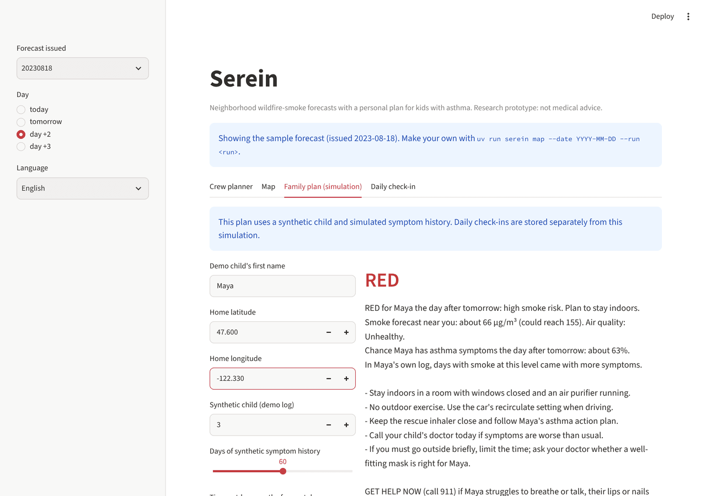
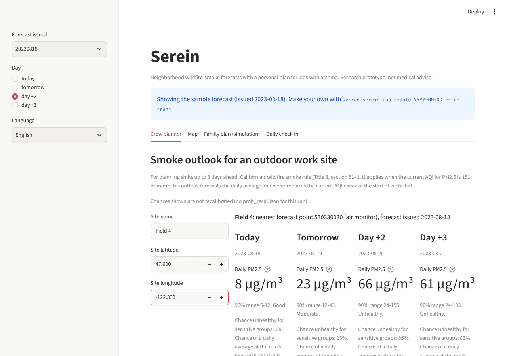
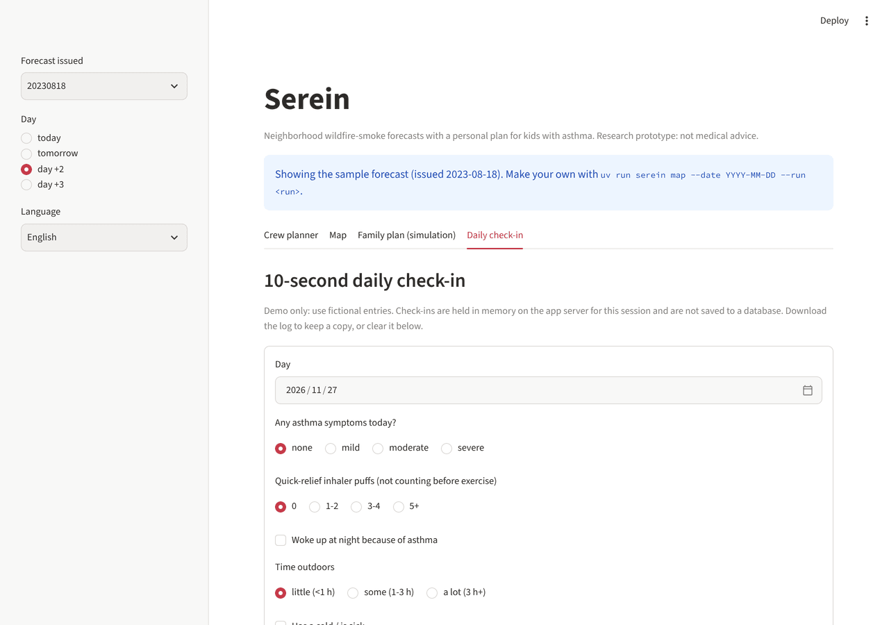

# What the demo app shows (screenshots, 2026-11-27)

The family plan, the crew outlook and the daily check-in live in the demo app
(`app/streamlit_app.py`), not on the public website. These screenshots let a reader see
them without installing anything. To run the app yourself:

```bash
uv sync --all-extras
uv run streamlit run app/streamlit_app.py
```

All three use the sample forecast shipped in `app/sample/` (issued 2023-08-18). They were
taken with the sidebar set to "day +2", which is August 20, 2023, and the location set
to Seattle (47.60, -122.33), where that forecast says 66 µg/m³ with a range of 24 to 155.
The website's August 2023 example shows the same values for the Seattle area.

## Family plan (simulation)



A RED plan for "Maya", a synthetic child with 60 days of simulated symptom history. The
plan gives the forecast, the model's chance of symptoms for this child (63%), what to
do, emergency signs, and the line "Always follow the asthma action plan from your child's
doctor." Nothing here comes from a real child.

## Crew planner



The outdoor work outlook for the same place: daily PM2.5, the 90% range and the chance
of an "Unhealthy for Sensitive Groups" day for each of four days. The page says the
outlook never replaces the current-AQI check that California's smoke rule requires.
The chances here are not recalibrated, because the trained run's settings
(`prob_recal.json`) are not in the repository; the app says so on the page.

## Daily check-in



The 10-second check-in: symptoms, quick-relief inhaler puffs, night waking, time
outdoors and whether the child has a cold. In the demo it takes fictional entries, holds
them in memory for the session and does not feed the personal model yet.

## Not shown, and why

- **Map tab.** It needs map tiles and graphics the screenshot machine could not load. The
  website's forecast map shows the same forecasts.
- **Spanish.** The language switch works, but the Spanish text is a draft waiting for a
  native-speaker review (task C-7), so it is not shown here.

The plan wording has not yet been reviewed by a clinician (task C-8). Until it is, these
screenshots show what the prototype does, not advice anyone should follow.
